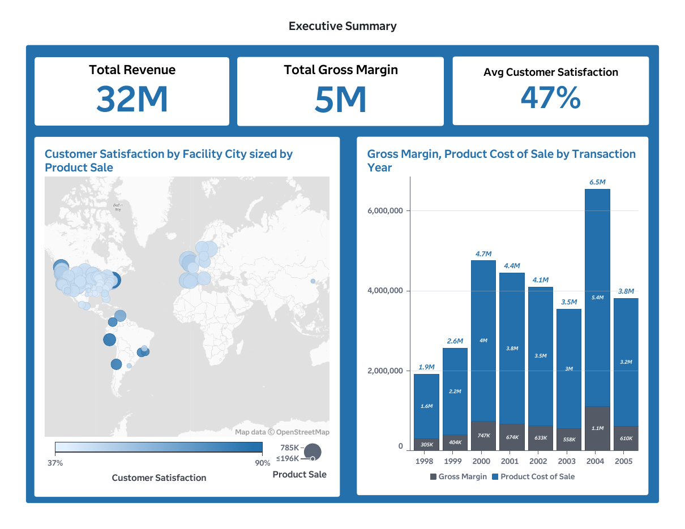
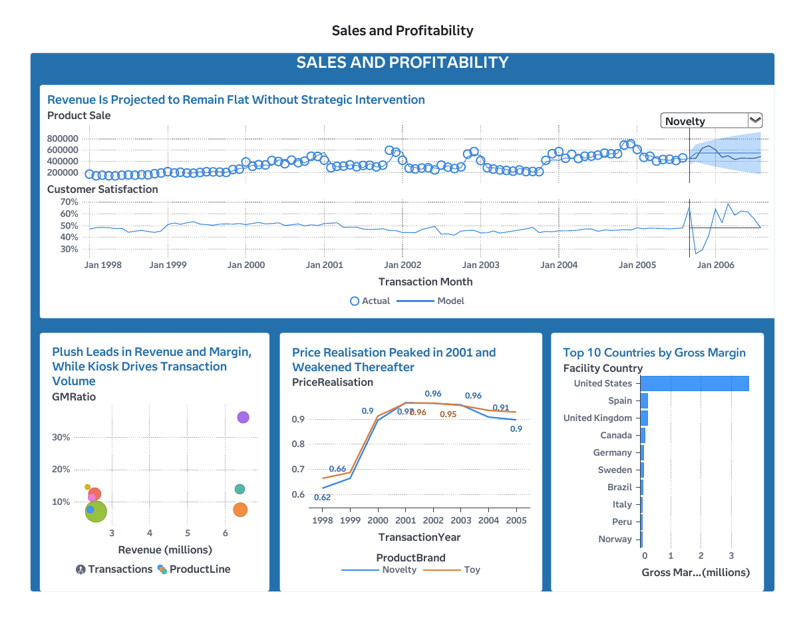
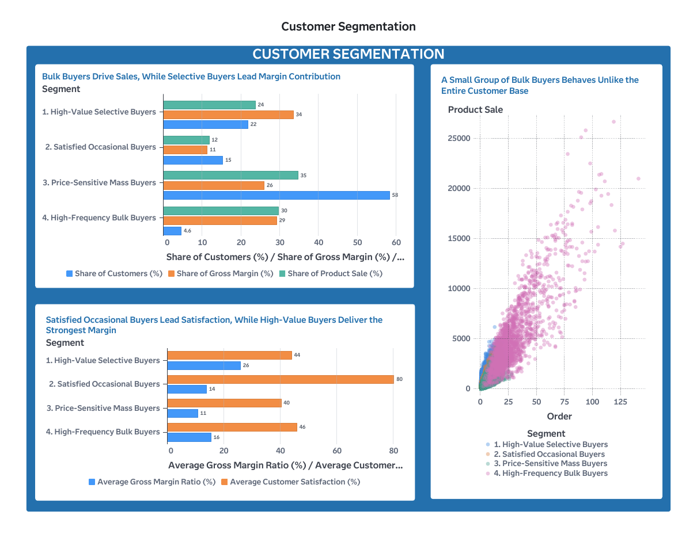
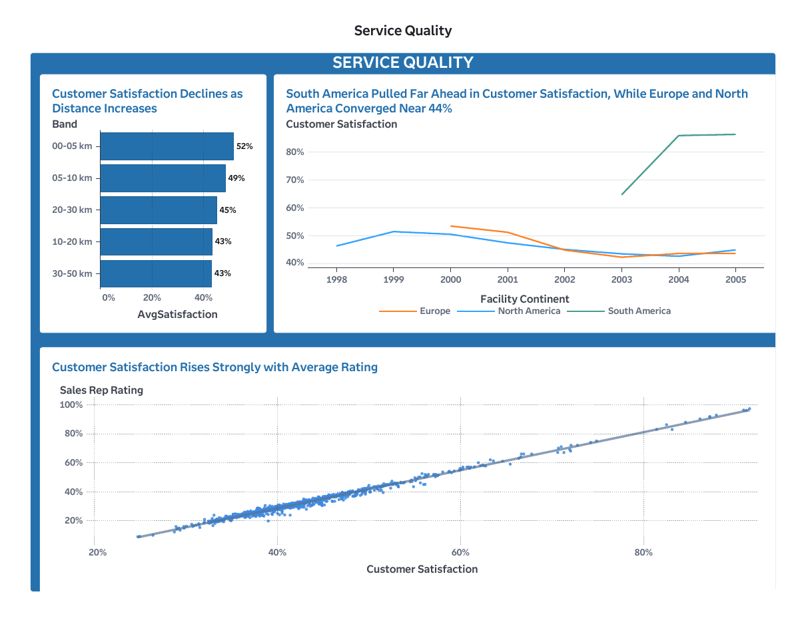

# Where is a toy manufacturer's value really created — and where is it at risk?

   

Customer intelligence analysis of **1.6 million transactions** (Jan 1998 – Sep 2005) from *Insight Toys*, a SAS demo dataset describing a toy manufacturer with 99 facilities in 18 countries and eight product lines.

Python is used for data preparation, forecast model comparison and validation. SAS Visual Analytics is used for K-means segmentation, ARIMAX scenario analysis and a four-page decision dashboard.

**The short answer:** the problem isn't sales volume — it's *where* value comes from. Profit is concentrated in a few product lines, satisfaction is falling in the largest market, and 4.6% of customers generate nearly 30% of revenue while sitting furthest from a facility.

---

## Key findings

### 1. Transaction volume and profit are misaligned
- **Plush** generates **46.8% of gross margin** from ~20% of revenue (gross margin ratio **36.3%**).
- **Kiosk** accounts for **34.7% of transactions** but averages **$4.66** per sale at a **7.0%** margin ratio — high processing activity for little contribution.
- Overall gross margin ratio: **15.9%** on **$31.6M** revenue.

### 2. Satisfaction is weakest where revenue is largest
- North American satisfaction fell from **51.5% (1999) to 42.7% (2004)** — the region generating **68.3%** of 2003–05 revenue.
- South America averaged **78.5%**, serving as an internal benchmark.
- Customers within **5 km** of a facility average **51.6%** satisfaction vs **43.1%** at 30–50 km.
- Sales-rep rating and satisfaction are almost perfectly correlated at rep level (**r = 0.993**) — treated as a strong association, not proof of cause.

### 3. Pricing discipline weakened after 2001
- Price realisation (actual ÷ target price) peaked at **96.5% in 2001** and fell to **91.6% in 2005**.

### 4. A small segment carries a large share of revenue risk
K-means (k = 4) on 39,327 customers:

| Segment | % Customers | % Revenue | % Gross Margin | Avg Satisfaction | Avg Distance |
|---|---|---|---|---|---|
| High-Value Selective Buyers | 21.8% | 23.7% | **33.5%** | 44.0% | 8.5 km |
| Satisfied Occasional Buyers | 15.3% | 11.8% | 11.3% | **80.2%** | 10.4 km |
| Price-Sensitive Mass Buyers | 58.3% | 34.7% | 26.0% | 40.3% | 9.5 km |
| High-Frequency Bulk Buyers | **4.6%** | **29.7%** | 29.2% | 45.9% | **35.7 km** |

High-Frequency Bulk Buyers average **30 orders** each (vs ~3 for every other segment) and are located 3–4 times further from a facility.

---

## Forecasting

Seven models were trained on Jan 2001 – Dec 2004 and evaluated on an **out-of-sample holdout (Jan – Aug 2005)**:

| Model | MAD | MAPE | Bias |
|---|---|---|---|
| Moving Average (3-month) | 67,353 | 14.57% | −58,957 |
| Moving Average (6-month) | 91,901 | 20.72% | −81,605 |
| Exponential Smoothing (α = 0.1) | 57,534 | 12.43% | −29,294 |
| Exponential Smoothing (α = 0.3) | 68,718 | 15.53% | −66,512 |
| Exponential Smoothing (α = 0.5) | 62,941 | 13.67% | −54,672 |
| **Regression (trend + monthly dummies)** | **27,424** | **6.02%** | **−5,166** |
| Seasonal ARIMA | 138,574 | 30.71% | −138,574 |

- The **regression model halved the error** of the next-best model and was selected; refitted, it forecasts **$512,909** revenue for August 2006.
- A SAS **seasonal ARIMAX** model using lagged customer satisfaction as an input forecasts **$488,834**. The two estimates are used as a **planning range (~$489K–$513K)**, not a single point.

### Scenario analysis (SAS ARIMAX)

| Scenario | Satisfaction input | Aug 2006 forecast | vs Baseline |
|---|---|---|---|
| Pessimistic | 42.7% (North America, 2004) | $448,082 | −8.3% |
| Baseline | 48% (current) | $488,834 | — |
| Optimistic | 51% (company level, 1999) | $509,230 | +4.2% |

Moving from the pessimistic to the optimistic satisfaction level is associated with **~$61K/month** more revenue. Goal seeking shows a **$550K** monthly target corresponds to roughly **57%** satisfaction. These are associative sensitivities, not causal estimates.

---

## Recommendations

| Action | Owner | Timeline | Decision gate |
|---|---|---|---|
| **North American sales-service pilot** — coaching and response standards for a treatment group of reps vs a control group | Sales Director | 90 days | Expand only if satisfaction improves without margin erosion |
| **Service-access pilot for distant bulk buyers** — account management and delivery support before any new facility | Regional Operations | 12 weeks | Invest only if incremental margin exceeds service cost |
| **Pricing governance** — justify sales materially below target price; review Kiosk on a cost-to-serve basis | Finance & Product | Monthly | Continue where price realisation improves without unacceptable volume loss |

Each recommendation is framed as a **controlled test**, because the underlying relationships are observational.

---

## Dashboard (SAS Visual Analytics)


## Dashboard (SAS Visual Analytics)

### Executive Summary


### Sales & Profitability


### Customer Segmentation


### Service Quality

  
---

## Methodology

**Data preparation (Python, cross-checked in SAS Viya)**
- Converted 7 percentage-text fields to decimals and comma-formatted text to numeric; verified MM/DD/YY date order via field-range checks.
- Derived Gross Margin, Gross Margin Ratio and Price Realisation — **ratios calculated from aggregated totals**, not averaged per transaction, to avoid over-weighting low-value sales.
- Reconciled Python and SAS: identical record counts (1,600,000); revenue within 0.009% and margin within 0.19%.

**Data quality decisions**
- **September 2005 excluded** from modelling — the data end on 7 Sep, so the partial month would look like a demand collapse.
- **1998–2000 excluded from forecast training** — a structural break (price realisation 0.65–0.91, ~30% zero-price transactions) during market entry.
- **Market basket analysis rejected** — all 180,450 orders contain a single product style, so no baskets exist.
- **Unit Status dropped** — every record is "Active".

**Segmentation**
- Aggregated to **one row per customer** (39,327) so no customer lands in multiple clusters.
- Five behavioural variables: total sales, order count, average order value, gross margin ratio, average satisfaction; Z-score standardised.
- Compared k = 3, 4, 5 (silhouette 0.276 / 0.293 / 0.310); chose **k = 4** as the balance between separation and business interpretability.

---

## Limitations
- Data cover 1998–2005 and may not reflect current market conditions.
- The r = 0.993 rep-level correlation may reflect shared measurement or territory effects.
- The SAS 95% forecast interval is wide ($160K – $897K); forecasts support planning ranges, not budgets.
- Silhouette scores indicate modest cluster separation — segments are managerial groupings, not hard boundaries.

---

## Repository structure

```
├── dashboard/      SAS Visual Analytics dashboard pages (PNG)
├── outputs/        Model comparison, segment profiles and scenario results (CSV)
└── README.md
```

The source dataset (INSIGHT_TOY_DEMO, SAS) is not redistributed here.

## Tools
Python (pandas, statsmodels, scikit-learn) · SAS Visual Analytics / SAS Viya · K-means clustering · Regression, exponential smoothing, SARIMA and ARIMAX forecasting
